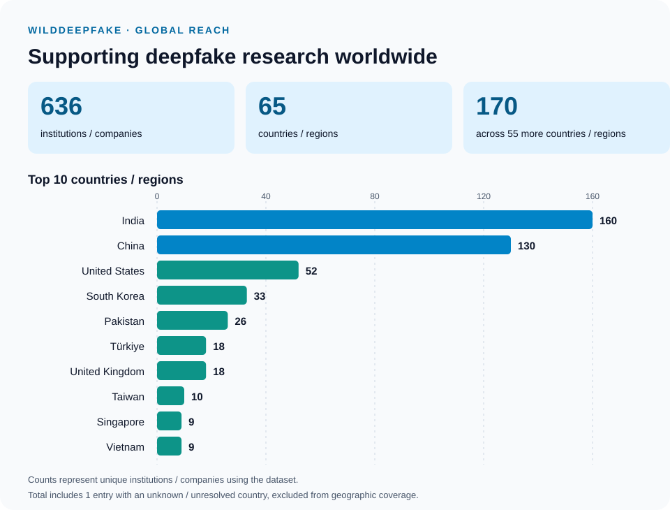

<h2>WildDeepfake: A Challenging Real-World Dataset for Deepfake Detection</h2>

<p align="center">
</img>
</p>

## 📌 Dataset Description
   
Existing deepfake datasets like DeepfakeDetection and FaceForensics++ have advanced detection research but are limited by constrained real videos featuring a few actors and fake videos generated using popular software. As a result, detectors trained on these datasets often struggle with the diversity of real-world deepfakes found online.

To address this, we introduce **WildDeepfake**, a dataset of **7,314** face sequences from **707** deepfake videos sourced entirely from the internet. Despite its small size, WildDeepfake better represents the challenges of real-world detection, where baseline detectors show significantly reduced performance.

To enhance detection, we also propose **Attention-based Deepfake Detection Networks (ADDNets)**, utilizing 2D and 3D attention mechanisms to improve focus on real/fake facial features. 


## 📂 Dataset Contents
   1. **A comparision to previous datasets (before our work)**
   
   |       Dataset name       |         Download         |Generate method|      Deepfake videos     |           Actors           |
   |--------------------------|--------------------------|----|--------------------------|----------------------------|
   |   Deepfake-TIMIT low     |[download](https://www.idiap.ch/dataset/deepfaketimit)|Deepfake|320|32|
   |   Deepfake-TIMIT high    |[download](https://www.idiap.ch/dataset/deepfaketimit)|Deepfake|320|32|
   |   Faceforensics          |-|Deepfake|1000|977|
   |   Faceforensics++        |[download](https://github.com/ondyari/FaceForensics)|Deepfake|1000|977|
   |   Deepfake detection     |[download](https://ai.googleblog.com/2019/09/contributing-data-to-deepfake-detection.html)|Deepfake|over3000|28|
   |Celeb-deepfakeforensics v1|[download](https://github.com/danmohaha/celeb-deepfakeforensics)|Deepfake|795|13|
   |Celeb-deepfakeforensics v2|[download](https://github.com/danmohaha/celeb-deepfakeforensics)|Deepfake|590|59|
   |   DFDC                   |[download](https://deepfakedetectionchallenge.ai/)|Deepfake|-|-|
   |   **WildDeepfake**   |[**download**](https://huggingface.co/datasets/xingjunm/WildDeepfake)|**Internet**|**707**|**Unknown**|
   

2. **File Structure**:
~~~
deepfake_in_the_wild
                    |--real train
                                 |--0.tar.gz
                                 |--1.tar.gz
                                 |--2.tar.gz
                                 ...
                    |--real test
                                |--0.tar.gz
                                |--1.tar.gz
                                |--2.tar.gz
                                ...
                    |--fake train
                                 |--0.tar.gz
                                 |--1.tar.gz
                                 |--2.tar.gz
                                 ...
                    |--fake test
                                |--0.tar.gz
                                |--1.tar.gz
                                |--2.tar.gz
                                ...
~~~

In each tar.gz file, there will be several folders containing face images, and the images in each folder represent a face sequence.
The image name in the folder represents the frame number it appears in the original video.

<!---
### Our ADDNet-2D Detection Method
<p align="center">
</img>
</p>   
   The network structure of our proposed ADDNet-2D is illustrated below. Detailed structures of the three residual blocks used in our ADDNet-2D network are shown below too. These three blocks are also the building blocks of XceptionNet. The base network before the "resblock3" is our proposed ADDblock. Our ADDNet-3D shares the same ADD block architecture as ADDNet-2D, but has one ADD block for each of the face images in the sequence. Therefore, in our setting with face sequence length 𝐿, ADDNet-3D will have 𝐿 ADDblocks, and each ADD blocks share the same weights. Also different from ADDNet-2D, the classifier network(structure after the ADDblock) of ADDNet-3D is a 3D CNN.
<p align="center">
</img>
</p>

### Expriments
First, we use pre-trained [Resnet-101](https://github.com/tensorflow/models/tree/master/research/slim) to extract features from the images in previous datasets and our dataset. Then we use the [T-SNE](http://projector.tensorflow.org/) to reduce the dimensionality. Red points represent fake faces, green points represent real faces. Here is the comparison:

<p align="center">
</img>
</p>
--->

## ⬇️ Request for Download
You will need to complete an agreement [form](https://forms.gle/o8vy9Q8fQ5mQZ4Qk6) to use the dataset. **⚠️ However, please note that due to the high volume of requests, we may not reply to your email unless your request is rejected.**


The dataset is now avalibble on Hugging Face [click to download](https://huggingface.co/datasets/xingjunm/WildDeepfake).

## 📜 Cite Us
If you use this dataset in your research, please cite it as follows:

```
@inproceedings{zi2020wilddeepfake,
  title={Wilddeepfake: A challenging real-world dataset for deepfake detection},
  author={Zi, Bojia and Chang, Minghao and Chen, Jingjing and Ma, Xingjun and Jiang, Yu-Gang},
  booktitle={Proceedings of the 28th ACM International Conference on Multimedia},
  pages={2382--2390},
  year={2020}
}
```

## 📝 Privacy Statement

To ensure the privacy of individuals featured in the dataset, we have implemented the following measures:

- **Restricted Use**: The dataset is strictly for research purposes, and only face sequences are released, not full videos.
- **Privacy Protection in Publications**: Key facial features are obscured in all visual materials, including papers and presentations. Additionally, strict access controls are in place.
- **Applicant Verification**: Access is granted only after verifying the applicant’s academic email address, personal electronic signature, and other necessary credentials.
- **Usage Agreement**: Applicants are required to sign a comprehensive agreement to ensure the dataset is used exclusively for research purposes.
- **Right to Removal**: If any part of the dataset impacts you, please [contact us](mailto:danxjma@gmail.com) to request its removal. 

We are committed to safeguarding privacy while enabling research advancements.

## 🌍 Dataset Impact & Global Reach

WildDeepfake is used by **636 unique institutions and companies** across **65 countries and regions**, supporting a global community working on deepfake detection. The total includes **one institution/company whose country is unknown or unresolved**; this entry is excluded from the geographic coverage count.



The chart highlights the ten countries and regions with the largest counts. A further **170 institutions and companies** are spread across the remaining **55 countries and regions**.

<details>
<summary><strong>Explore the complete country / region breakdown</strong></summary>

| Rank | Country / Region | Unique Institutions / Companies |
| ---: | :--- | ---: |
| 1 | India | 160 |
| 2 | China | 130 |
| 3 | United States | 52 |
| 4 | South Korea | 33 |
| 5 | Pakistan | 26 |
| 6 | Türkiye | 18 |
| 7 | United Kingdom | 18 |
| 8 | Taiwan | 10 |
| 9 | Singapore | 9 |
| 10 | Vietnam | 9 |
| 11 | Australia | 8 |
| 12 | Brazil | 8 |
| 13 | France | 8 |
| 14 | Indonesia | 8 |
| 15 | Malaysia | 8 |
| 16 | Bangladesh | 7 |
| 17 | Italy | 7 |
| 18 | Egypt | 6 |
| 19 | Germany | 6 |
| 20 | Japan | 6 |
| 21 | Spain | 6 |
| 22 | Iran | 5 |
| 23 | Philippines | 5 |
| 24 | Thailand | 5 |
| 25 | Canada | 4 |
| 26 | Israel | 4 |
| 27 | Poland | 4 |
| 28 | United Arab Emirates | 4 |
| 29 | Iraq | 3 |
| 30 | Nigeria | 3 |
| 31 | Russia | 3 |
| 32 | Sri Lanka | 3 |
| 33 | Algeria | 2 |
| 34 | Austria | 2 |
| 35 | Belgium | 2 |
| 36 | Greece | 2 |
| 37 | Ireland | 2 |
| 38 | Kazakhstan | 2 |
| 39 | Nepal | 2 |
| 40 | Netherlands | 2 |
| 41 | Norway | 2 |
| 42 | Palestine | 2 |
| 43 | Portugal | 2 |
| 44 | Romania | 2 |
| 45 | Saudi Arabia | 2 |
| 46 | Slovenia | 2 |
| 47 | South Africa | 2 |
| 48 | Switzerland | 2 |
| 49 | Azerbaijan | 1 |
| 50 | Bulgaria | 1 |
| 51 | Burkina Faso | 1 |
| 52 | Colombia | 1 |
| 53 | Ethiopia | 1 |
| 54 | Finland | 1 |
| 55 | Hungary | 1 |
| 56 | Jordan | 1 |
| 57 | Kenya | 1 |
| 58 | Libya | 1 |
| 59 | Morocco | 1 |
| 60 | Oman | 1 |
| 61 | Peru | 1 |
| 62 | Qatar | 1 |
| 63 | Sweden | 1 |
| 64 | Syria | 1 |
| 65 | Ukraine | 1 |
| — | Country unknown/unresolved | 1 |
| | **Total** | **636** |

</details>

[Download the country-level counts (CSV)](./assets/dataset-usage-by-country.csv).

*Counts describe institutional/company use of the dataset, rather than individual users, downloads, or citations.*

WildDeepfake has been adopted by researchers from more than **40 universities**, including Stanford, MIT, Princeton, UC Berkeley, Columbia, and Johns Hopkins.
